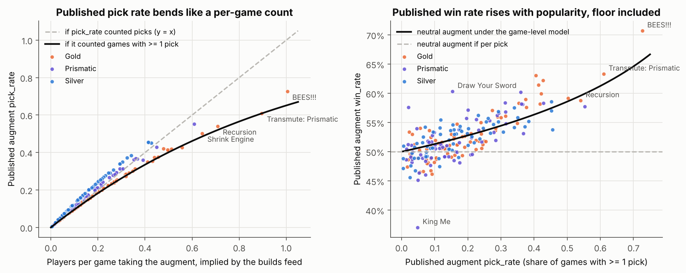
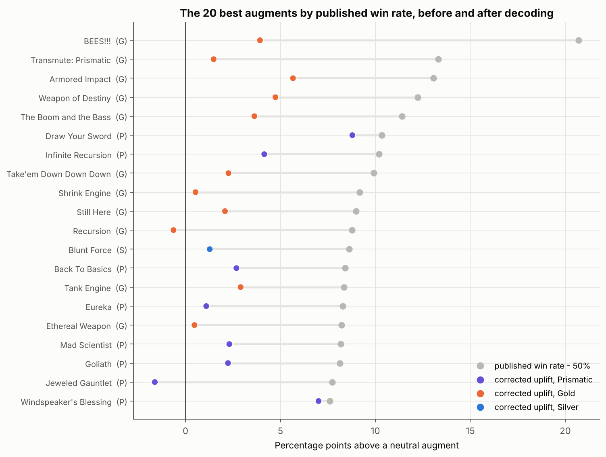
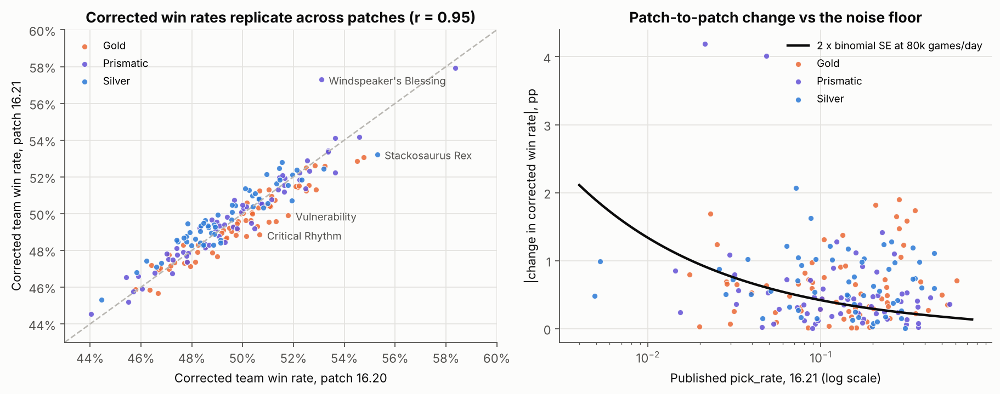
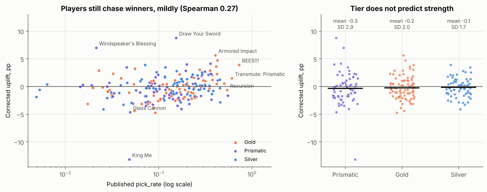
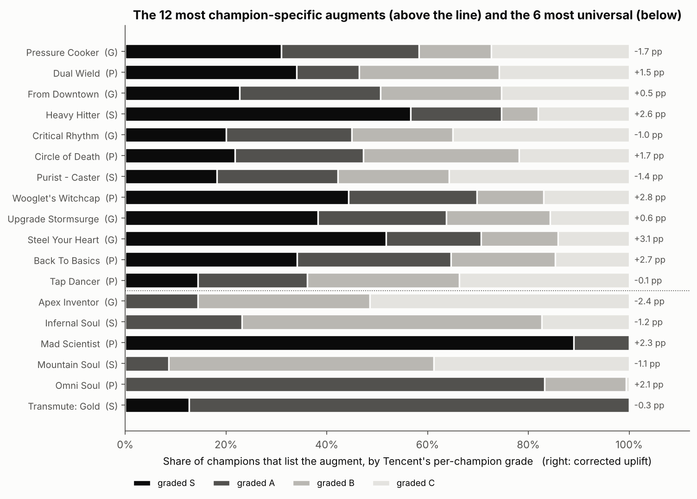

# Which augments actually win?

*De-inflating Tencent's Mayhem augment statistics, then ranking what is left. Notebook:
[`augment-uplift.ipynb`](augment-uplift.ipynb).*

## The question

DeepARAM shows Tencent's official ARAM Mayhem augment stats for the China server
(`data/cn/augments.json`): BEES!!! wins 70.7% of its games, King Me 37.0%. The question this
notebook set out to answer was **which augments actually raise a player's win rate, once small
samples are shrunk and the champions who pick them are controlled for**. The answer turned out to
need a step before either of those: working out what the published numbers mean.

## The data

One day of the augment feed (2026-10-28, seven days into patch 16.21; 214 augments with win rate,
pick rate and rarity), the per-champion builds feed (`data/cn/builds/`: 173 champions, each with
its most-taken augments' pick share and Tencent's S/A/B/C grade, 21,031 champion-augment rows),
the champion feed (baseline win and pick rates), two patch windows of daily augment snapshots
(`data/cn/history/augments/`, 16.20 and 16.21) and the simulator's augment names, rarities and
per-champion pools. Tencent publishes no sample sizes and does not document its definitions.

## Method

1. **Decode the feed.** A sample of picks must average 50% when weighted by picks. The champion,
   skill-order and item feeds all do; the augment feed averages **54.4%**. Two further checks
   identify why: (a) summing `champion pick rate x per-champion augment share` gives each
   augment's picks per game, and the published pick rate matches `1 - (1 - picks/10)^10`, the
   share of *games* containing the augment, five times better than it matches the picks
   themselves for popular augments; (b) the *lowest* published win rate in each popularity band
   rises with pick rate, exactly along the curve a neutral augment would trace if win rate were
   "share of games containing the augment that a team holding it won". When both teams hold it,
   the game is a win however it ends. The fix follows with no fitted parameters: with
   `q = 1 - sqrt(1 - pick_rate)` the chance a given team has the augment, the team win rate is
   `w = win_rate x (1 - q/2)`.
2. **Composition.** Expected win rate from the picker mix, `E`, is the pick-weighted mean of the
   pickers' champion baselines; uplift is `w - E`.
3. **Shrinkage.** Volume is inferred from the sibling notebook's lower bound of 80,000 games a
   day; binomial standard errors give empirical-Bayes shrinkage toward the rarity mean. The
   previous patch window provides a test-retest check that needs no volume assumption.
4. **Rank, compare rarities, measure selection** (pick rate vs uplift, and an OLS of `w` on
   rarity, `E` and log pick rate with HC3 errors) and **champion-specificity** (how polarised
   Tencent's per-champion grades are, cross-checked against the dispersion of pick shares).

## Findings

### 1. The published augment win rates are per game, not per pick, and popular augments are inflated by it



After the correction the team-games-weighted mean is **50.3%** (the residual is the
independence approximation and the truncated tail of each champion's list) and the floor is
flat: the worst augment in every popularity band sits at 45 to 47%. The spread of effects
shrinks from a published range of 37 to 71% to a corrected **37 to 58%** (SD 2.4 pp instead of
3.8). The site's current fix in `web/src/lib/augment-winrate.ts` regresses win rate on pick rate
within each rarity, which removes real selection along with the artifact and re-centres each
rarity by assumption; the closed form removes only the arithmetic.

### 2. The corrected ranking



By shrunk, composition-adjusted uplift the top five are **Draw Your Sword +8.8 pp, Windspeaker's
Blessing +7.0, Armored Impact +5.7, Weapon of Destiny +4.7 and Infinite Recursion +4.1**. BEES!!!,
new this patch and taken in 73% of games, falls from +20.7 to **+3.9 pp** (seventh): good, not
broken. Recursion and Shrink Engine, both published near 59%, are within a point of neutral; they
are taken because they are offered to everyone and are fine. The bottom is **King Me -13.2 pp**,
Brass Blast -4.7, Glass Cannon -4.6, Upgrade Sundered Sky -4.4 and Spin Me Right Round -4.1. King
Me is the one genuinely enormous effect: it trades the current pick for extra picks later, so the
team plays a player down for a stage, and a 15-minute mode rarely pays that back.

### 3. Who picks it, and how many of them, barely matter

The champion-mix baseline `E` ranges from 48.5 to 51.7% (SD 0.5 pp): ARAM's random assignment and
broad pools keep every augment's pickers close to the population. Volume is large enough that the
median standard error is 0.17 pp and the largest (Flash 2, taken in 0.5% of games) is 0.95 pp;
shrinkage moves four augments by three or more ranks and none in the top or bottom thirty.



The corrected team win rates of the 183 augments present in both windows agree at **r = 0.95**
across patches 16.20 and 16.21, despite 31 augments rotating in and 28 out. A third of the
patch-to-patch changes exceed three sampling standard deviations and they are not concentrated
among rare augments, so, as the sibling notebook found for champions, most movement is real.
Windspeaker's Blessing (2% pick rate, moved 4 pp) is the least secure name in the top ten.

### 4. Rarity does not predict strength; players still chase winners, mildly



Prismatic, Gold and Silver all average within 0.4 pp of zero uplift; Prismatic merely has the
widest spread, and that spread is two augments (Draw Your Sword and King Me). Popularity and
rarity explained almost half of the published win rates (R^2 0.45); after correction the same
model explains 0.15, with log pick rate worth +0.5 pp per e-fold. The Spearman correlation between
pick rate and uplift falls from **0.73 to 0.27**. That residual is the selection the question
anticipated: players take augments that fit, so every number here is the effect among games where
someone chose the augment, not the effect of forcing it on a random player.

### 5. Champion-specific augments



Tencent's per-champion grade is undocumented, but it is not the pick order (they disagree on 8% of
within-champion pairs) and an augment's share of S grades tracks its corrected uplift at Spearman
0.73, so it carries per-champion win information that is otherwise unpublished. The most polarised
augments (S on some champions, C on others) are kit-dependent: **Dual Wield** and **Critical
Rhythm** are S on Vayne and Jinx and C on casters, **Heavy Hitter** and **Steel Your Heart** are S
on Dr. Mundo and Ornn, **From Downtown** wants artillery mages, **Wooglet's Witchcap** AP burst.
The most universal are flat stat buys (Mad Scientist, Omni Soul, Transmute: Gold). Grade
polarisation agrees with the grade-free dispersion of pick shares (Spearman 0.52).

## Limitations

- **The game-level model is inferred.** Three independent checks support it and it has no free
  parameters, but Tencent does not document the feed, and the correction assumes the two teams'
  augment draws are independent.
- **Offered vs picked.** Everything is conditional on a player choosing the augment. That is what
  a player comparing three cards needs, but it is not a causal effect.
- **Volume is estimated** from a lower bound; standard errors scale with its square root. The
  test-retest check does not depend on it.
- **No per-champion win rates are published.** Composition is handled through `E` and
  specificity through an undocumented grade. Builds lists are truncated at 93 to 157 of 214
  augments per champion, which biases the implied picks of rare augments downward.
- **One server, one week.** 31 augments (BEES!!! included) are new in 16.21 and have no earlier
  window to replicate against.

## What the site should do

1. Replace the within-rarity detrend with `w = win_rate x (1 - q/2)`, `q = 1 - sqrt(1 - pick_rate)`;
   the result is a team win rate directly comparable with champion win rates.
2. Show augments as signed uplift in percentage points ("BEES!!! +3.9 pp"), not as a win rate.
3. Keep the composition adjustment already in `augment-tiers.ts`; it is small but correct.
4. Re-run the notebook each patch window; the test-retest figure is the regression test.

## Reproduce

```
pip install -r analysis/augment-uplift/requirements.txt
cd analysis/augment-uplift
jupyter nbconvert --to notebook --execute --inplace augment-uplift.ipynb
```

Runs offline in under a minute from `data/cn/` and `simulator/data/` and rewrites the five PNGs.
