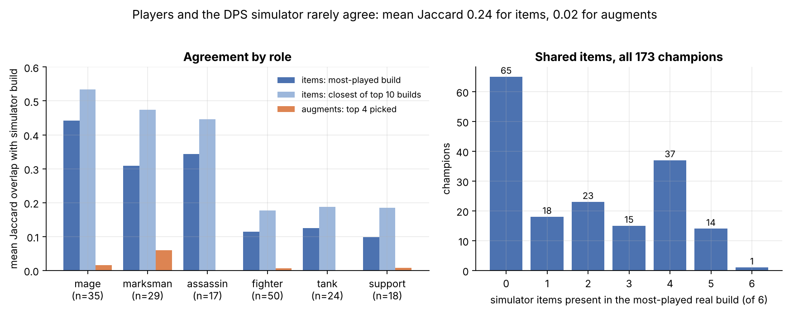
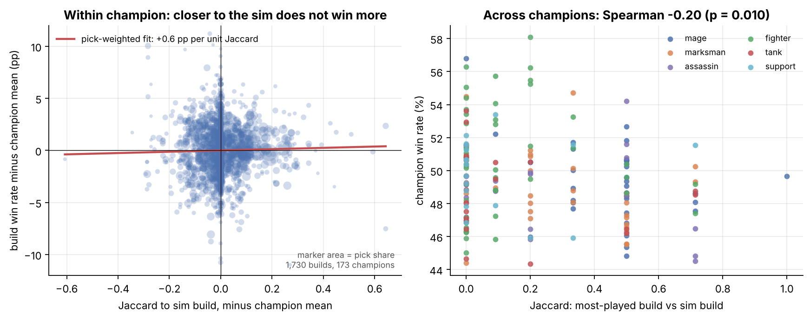
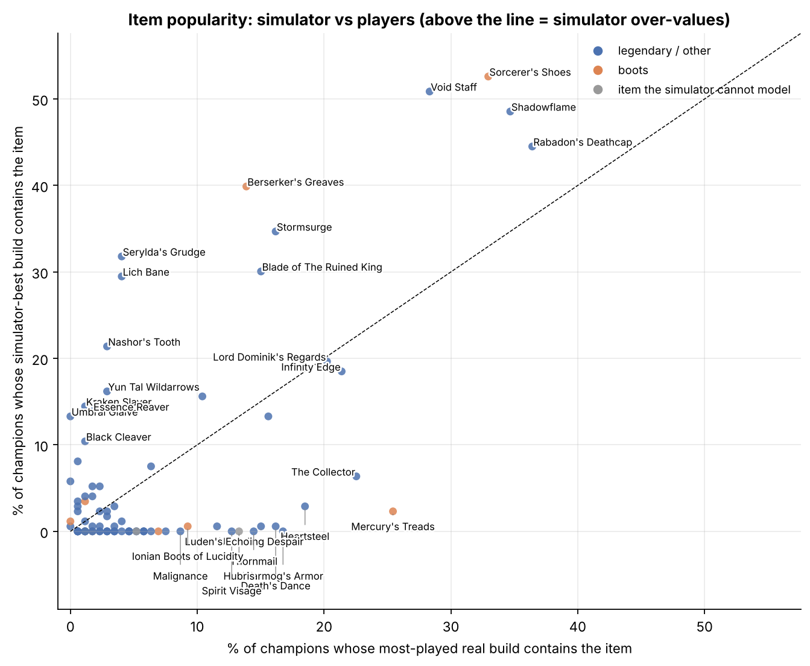
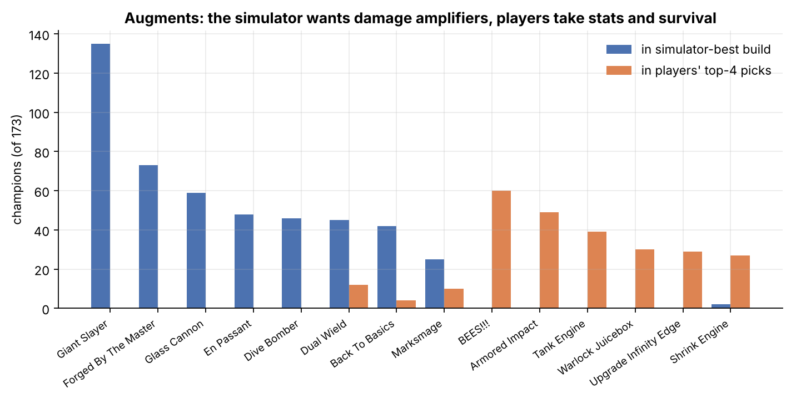

# Do players build what the simulator says is optimal?

*Players' most-popular ARAM Mayhem builds versus the repo's DPS-optimal builds, and whether agreeing
with the simulator wins games. Notebook: [`sim-vs-real-builds.ipynb`](sim-vs-real-builds.ipynb).*

## The question

DeepARAM ships two sources of build advice: the simulator's DPS-maximising build per champion
(`simulator/viewer/replay-data/best-builds.json`) and Tencent's China-server record of what players
actually build and how often it wins (`data/cn/builds/`). The question is **whether the two agree,
where they disagree, and whether real builds closer to the simulator's answer win more**. If they
did, the simulator would be a ranking signal; if not, it is a damage calculator and should be shown
as one.

## The data

One day of the builds feed (2026-10-28, patch 16.21): for each of 173 champions, the ten most-played
six-item full builds with pick share and win rate, the twenty most-bought single items, and per-champion
augment pick shares. The simulator's best six items and four augments per champion (145 champions with
a `good` kit parse, 28 `partial`), its item catalogue (`simulator/data/items.json`, used for names and
slots), its champion roles, and the champion feed for baseline win and pick rates. Tencent publishes no
sample sizes.

## Method

1. **Agreement.** Jaccard overlap (shared items over distinct items) between the simulator build and the
   champion's most-played real build, and the best overlap among the top ten. The same for the
   simulator's four augments against the four most-picked augments.
2. **Does agreement win?** Within champion: regress each of the ten builds' win rates on their Jaccard
   to the simulator, both demeaned by champion and weighted by pick share, with a champion-level
   bootstrap for the interval; per-champion Spearman as a non-parametric check. Across champions:
   Spearman between the top build's Jaccard and the champion's baseline win rate, raw and within role.
3. **Item-level.** For every item, the share of champions whose simulator build contains it against the
   share whose most-played real build does; the gap ranks what the simulator over- and under-values.
4. **Sample sizes.** Using the sibling notebook's lower bound of 80,000 games a day, the median top build
   has roughly 740 games behind it over the patch's seven days (binomial SE about 1.8 pp); tenth-ranked
   builds have about 210 (SE 3.5 pp). Build-level win rates are noisy, which is why the within-champion
   test pools 1,730 builds rather than reading individual ones.

## Findings

### 1. Players and the simulator rarely agree, and almost never on augments



Mean Jaccard between the simulator build and the most-played real build is **0.24** (median 0.20).
**38% of champions share zero items** with the simulator; 30% share four or more; the simulator's
exact build is among the top ten real builds for **5 champions of 173** (Sylas is the only exact
match at rank one). Fewer than half (48%) of the simulator's items appear in the champion's twenty
most-bought items at all, and boots agree 45% of the time. Augments are a different order of
disagreement: Jaccard **0.016**, and only 7% of the simulator's augments are in the champion's real
top ten. The simulator puts Giant Slayer in 135 of 173 builds and Forged By The Master in 73; neither
is a top-four pick on any champion. Players' top-four picks are BEES!!! (60 champions), Armored
Impact (49), Tank Engine (39) and Warlock Juicebox (30): stat and survival cards.

Agreement is a role story. Mages score 0.44 (3.5 of 6 items shared on average, boots agree 89%),
assassins 0.34 and marksmen 0.31; fighters, tanks and supports sit at 0.10 to 0.13 with one shared
item and a majority sharing none. The simulator maximises damage, so for roles whose players build
damage it is in the right neighbourhood; for roles whose job is not damage it recommends a different
class of build entirely. The marksman disagreements are instructive: on Ashe, Miss Fortune, Teemo and
Kai'Sa the simulator builds crit while players build full AP (Blackfire Torch, Rabadon's, Shadowflame),
the Mayhem AP-marksman meta the DPS search does not find.

### 2. Being closer to the simulator does not win more



Within champion, the pick-weighted slope of build win rate on Jaccard is **+0.6 pp per full unit of
Jaccard, 95% CI [-1.4, +2.5]**; unweighted it is -0.2 pp. The per-champion Spearman averages +0.04,
is positive for 52% of the 123 champions with any variation, and a Wilcoxon test gives p = 0.38.
Builds sharing 0 to 2 items with the simulator sit within 0.5 pp of their champion's mean, builds
sharing 3 to 5 within 0.2 pp above it. Simulated DPS does not show up as wins.

Across champions, the correlation is **negative** (Spearman -0.20, p = 0.01): champions whose popular
build matches the simulator win *less*. That is composition. The roles that agree most (mages,
assassins, marksmen) average 48.5 to 49.3% while fighters, who agree least, average 50.6%; within role
the correlation falls to -0.12 (p = 0.13). The simulator agrees with the roles that are weakest in
Mayhem, not with the champions that win.

### 3. What the simulator over- and under-values



Item frequencies on the two sides correlate at Spearman +0.22 (p = 0.04). The simulator over-values
penetration and pure damage multipliers: **Serylda's Grudge** (32% of sim builds, 4% of real),
**Berserker's Greaves** (40% vs 14%), **Lich Bane** (30% vs 4%), **Void Staff** (51% vs 28%),
Nashor's Tooth, Stormsurge, Kraken Slayer. It under-values everything that keeps a player alive:
**Mercury's Treads** (2% vs 25%), **Warmog's Armor** (0% vs 17%), Death's Dance, Heartsteel,
Thornmail, Unending Despair, Spirit Visage, all at 0 to 3% in sim builds and 13 to 19% in real ones.
The Collector (6% vs 23%) and Hubris, which the simulator cannot model, are the gold-generation and
snowball items players like in a fifteen-minute mode. Rabadon's, Shadowflame and Infinity Edge sit
near the diagonal: where an item is pure damage and the role builds damage, both sides agree.



## Why disagreement is expected

The simulator's objective is single-target DPS over a fight; it reports survival but does not optimise
for it. Players are optimising for winning a game, which rewards not dying (a 25-second death timer
in a mode where fights never stop), tenacity against Mayhem's crowd control, and gold tempo. Every
large gap in Figure 3 is one of those three. The simulator also searches a fixed six slots with no
notion of build order, while the real top build is the end state of a sequence chosen under gold
constraints. None of this makes the simulator wrong about damage; it makes damage the wrong thing to
rank builds by.

## Limitations

- **No sample sizes.** Build win rates are noisy (SE 2 to 4 pp), and the top ten builds cover a median
  13% of a champion's games; the long tail is invisible.
- **Selection, not causation.** Players choose builds by game state; a build's win rate is conditional
  on the situations that produced it.
- **One day, one server, one patch.** Augment pools rotate and 31 augments are new this patch.
- **The simulator's parse quality** is `partial` for 28 champions; restricting to the 145 `good`
  parses lowers the headline Jaccard to 0.22, so the partial parses are not what drives agreement.
- **Jaccard treats items as equal.** Boots count as much as a 3,000-gold legendary.

## What the site should do

Show the real build first and the simulator's as "if you only cared about DPS". Adding a survival
term to the simulator's objective is the natural next experiment; this notebook is its before/after test.

## Reproduce

```
pip install -r analysis/sim-vs-real-builds/requirements.txt
cd analysis/sim-vs-real-builds
jupyter nbconvert --to notebook --execute --inplace sim-vs-real-builds.ipynb
```

Runs offline in under a minute and rewrites the four PNGs.
