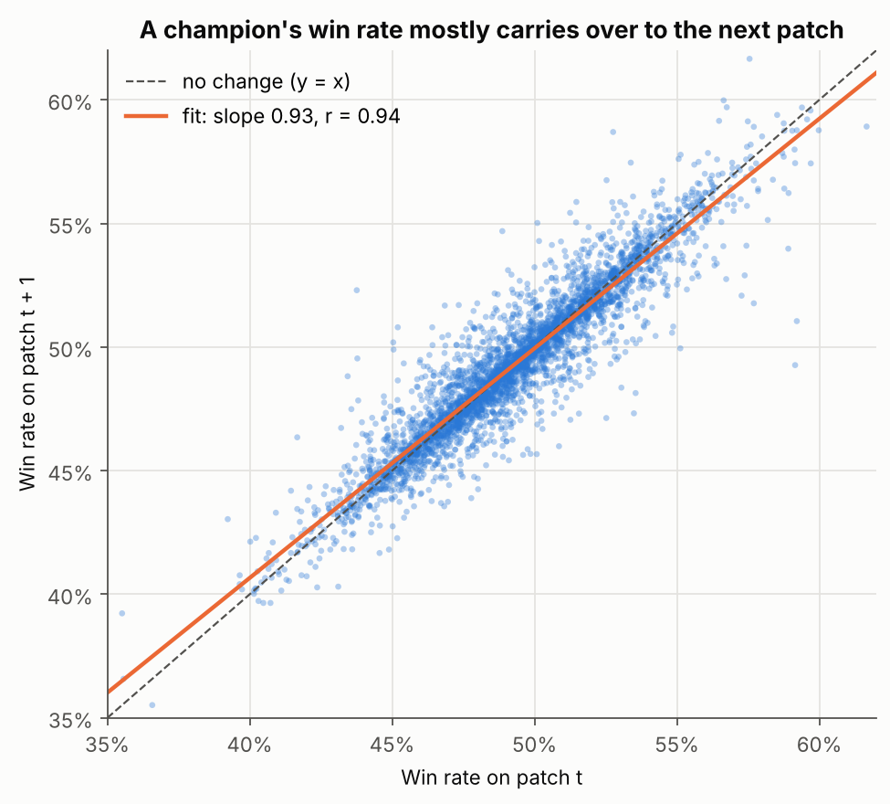
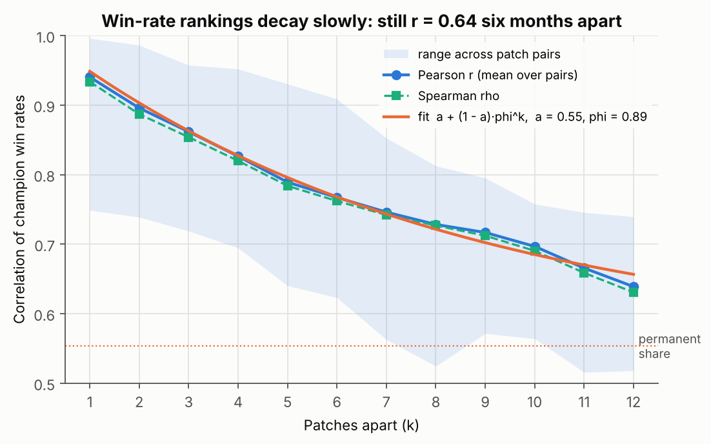
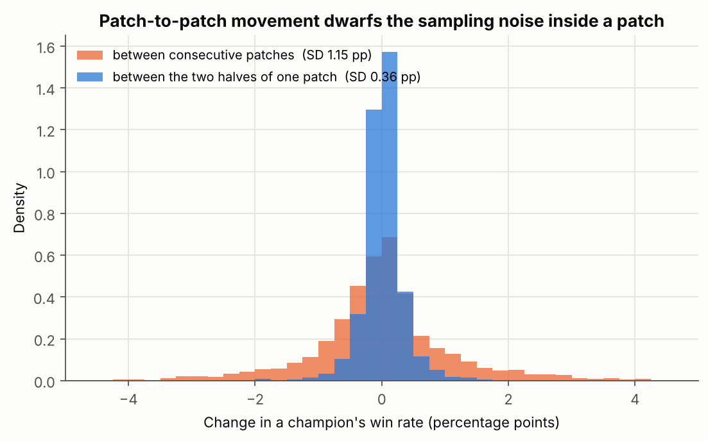
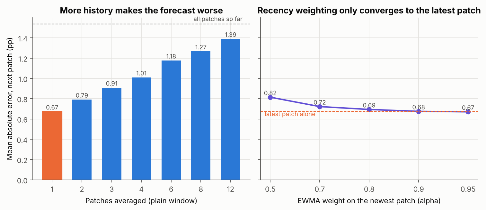
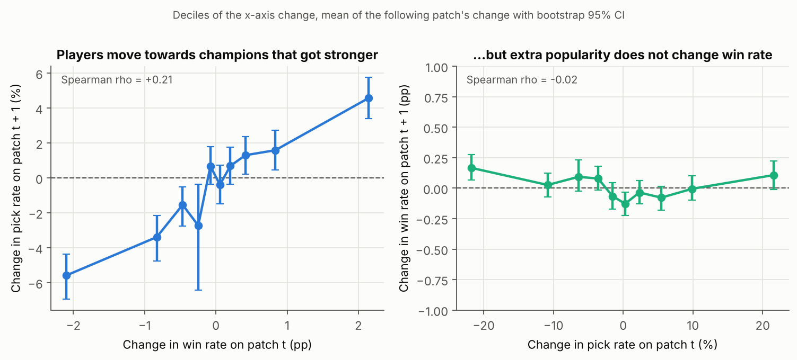
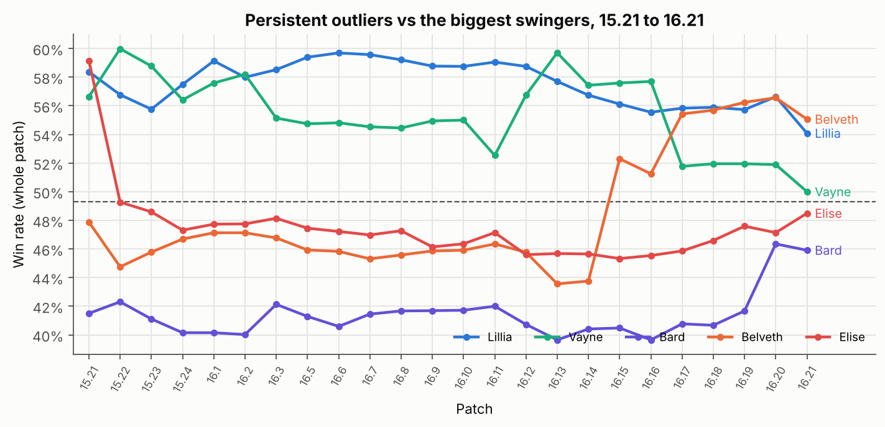

# How fast does the ARAM Mayhem meta move?

*Win-rate persistence across 24 patches on the China server. Notebook: [`win-rate-persistence.ipynb`](win-rate-persistence.ipynb).*

## The question

DeepARAM's tier list is built from Tencent's official Mayhem stats for the China server
(`data/cn/history/`), and the site can combine several patches, weighted by estimated games,
into one ranking. Whether that is a good idea depends on a question the data had not been
asked yet: **when a champion sits at 56% on the current patch, how much of that is still there
next patch, three patches later, or six months on?** Put differently, how much of the movement
between patches is real (balance changes, new augments, meta) and how much is sampling noise,
and what is the best forecast of next patch's win rate from the history we already have?

## The data

Twenty-four whole-patch snapshots, 15.21 (October 2025) to 16.21 (October 2026), with 171 to 173
champions each (4,133 champion-patch rows), plus the 361 daily cumulative snapshots behind them.
Each patch number is Tencent's own cumulative figure for the patch window, so it is a multi-week
average rather than a single day. The catch is that Tencent publishes no sample sizes, which
rules out the usual binomial confidence interval and shapes the whole method.

## Method

1. **Persistence.** Regress each champion's next-patch win rate on its current one (3,959
   champion-transitions, standard errors clustered by champion) and compute the lag-*k*
   correlation of the champion ranking for *k* = 1 to 12 patches. Fit
   `r(k) = a + (1 - a) * phi^k`, where `a` is the permanent share of between-champion spread and
   `phi` the one-patch survival of the transient part.
2. **Noise.** Two sample-size-free checks. (a) Sampling noise scales with 1/sqrt(n), so if it
   mattered, rarely picked champions would bounce more than popular ones. (b) Split-half
   reliability: because the daily files are cumulative, the second half of each patch window can
   be recovered by subtraction (games estimated as pick rate x days, the repo's own convention),
   and the agreement between the two halves is a direct measurement of noise with no balance
   changes in between. Inverting the binomial variance of the half-to-half difference gives a
   lower bound on the volume behind the feed.
3. **Forecasting.** Treat each patch as a target and score simple predictors built only from
   earlier patches (latest patch, plain *k*-patch averages, exponentially weighted averages,
   two naive baselines) by mean absolute error.
4. **Direction of the pick-rate/win-rate link.** Cross-lagged changes: does a change in win
   rate on patch *t* predict the change in pick rate on *t + 1*, or the reverse? Spearman on the
   changes, plus a levels regression with cluster-robust standard errors.

## Findings

### 1. Win rates are very persistent, and about half of a champion's edge is permanent



The next-patch slope is **0.93** (95% CI 0.92 to 0.94; Pearson r = 0.94, Spearman 0.93). A
champion 10 points above average this patch is expected 9.3 points above average next patch.



The ranking decays slowly: the correlation between patches twelve apart (about six months) is
still **0.64**. The fitted curve puts the permanent share at **a = 0.55** and the transient
persistence at **phi = 0.89** per patch, a **half-life of about six patches** (three months).
In words: roughly half of why Lillia wins and Bard loses is baked into the kit and the mode;
the rest is the current balance numbers, which turn over on a quarterly timescale.

### 2. The movement between patches is real, not noise

Residual spread is flat across pick-rate quintiles (1.6 to 1.8 pp, Spearman between pick rate
and absolute deviation 0.02), which is what negligible sampling noise looks like. The
split-half check says the same thing more directly: on 20 of 22 patches the two halves of the
window agree at **r = 0.99 or better**, with half-to-half differences of only 0.2 to 0.4 pp per
champion. Inverting the binomial variance implies **at least ~80,000 Mayhem games per day** on
the China server and a whole-patch win rate precise to roughly +/-0.2 pp.



Changes between consecutive patches (SD 1.2 pp, tails to +/-4 pp) are three to four times wider
than the noise inside a patch (SD 0.3 to 0.4 pp); in variance terms, sampling noise is under 10%
of the patch-to-patch movement. Two windows, **15.23 (split-half r = 0.82) and 16.12 (0.94)**,
break the pattern and look like mid-window changes or slightly misplaced window boundaries.

### 3. The latest patch alone is the best forecast; averaging history makes it worse



Predicting next patch from the latest patch alone gives a mean absolute error of **0.75 pp**
over all 23 targets (0.67 pp on the 12 targets every method can score). Every plain window is
worse, and the error grows steadily with window length: three patches 0.91 pp, twelve patches
1.39 pp, "all patches so far" 1.54 pp. An exponentially weighted average converges to the
latest-patch error as the recency weight goes to 1 and never beats it. That is exactly what the
noise result predicts: averaging is a remedy for noise, and there is almost none to remedy.

**Recommendation for the site:** make the newest patch the default tier-list window. Combining
patches by game count only costs accuracy on this feed; keep blending for sparser sources, and
weight recency rather than volume if you do.

### 4. Players chase winners, with a one-patch lag; popularity does not feed back into win rate



A change in win rate on patch *t* predicts the change in pick rate on patch *t + 1* (Spearman
**+0.21**, p = 1e-40): champions in the top decile of win-rate gains are picked about 5% more
(relative) the following patch, the bottom decile about 6% less. The reverse relation is absent
(Spearman -0.02, p = 0.24), and the same-patch correlation of the two changes is zero. In
levels, holding current popularity fixed, **each extra point of win rate buys about +0.5% more
picks next patch** (95% CI +0.34 to +0.62%), while doubling a champion's pick rate shifts its
next win rate by +0.03 pp (p = 0.17). The random-roll trade economy responds to strength, but
slowly and weakly, and the "popular champions get played badly" effect familiar from Summoner's
Rift statistics does not appear here.

### 5. The persistent outliers

Over 24 patches Lillia averages **57.6%** (95% interval over patches 56.9 to 58.2), followed by
Vayne 55.4, Brand 55.1, Gwen 54.8 and Seraphine 54.5. At the bottom, Bard averages **41.4%**,
K'Sante 42.1, Akali 43.1, LeBlanc 43.5 and Lee Sin 43.5. The most volatile champions (SD of
patch-to-patch change about 2.2 pp) are Bel'Veth, Vayne and Elise. Bel'Veth is the clearest
example of a real rework: 43% to 52% between 16.14 and 16.15, and 55% today.



## Limitations

- **One server, one mode.** The China-server population is large (which is why the noise is so
  small), but its meta may differ from Riot regions. The half-life and the chase-winners lag are
  about this population.
- **Games are estimated**, not counted, as pick rate x window days. The implied volume is a lower
  bound and an order-of-magnitude statement, and the split-half reconstruction inherits the
  same-volume-per-day assumption.
- **Patch windows are inferred** from jumps in the cumulative numbers near Tencent's release
  dates. 15.23 and 16.12 are flagged, not corrected.
- **The lag correlations overlap** (they share patches), so the curve fit's standard errors are
  optimistic; the shaded min-to-max band is the honest uncertainty.
- **Section 4 is a timing argument**, not an experiment. Anything that raises win rate on patch
  *t* and pick rate on *t + 1* through a separate channel (a skin, a streamer) would mimic it.

## Next steps

1. Switch the live tier list to the newest patch by default and re-run the forecast table after
   each patch to track the error.
2. Split the decay by champion class (`simulator/data/champions.json` roles): do balance changes
   hit tanks and mages differently?
3. Match the largest patch-to-patch moves to the datamined change lists in `data/pbe/` to turn
   "it is all real" into per-change effect sizes.
4. Repeat the split-half check around known augment-pool changes.
5. Replicate on a second region when a Riot-API Mayhem feed is available.

## Reproduce

```
pip install -r analysis/win-rate-persistence/requirements.txt
cd analysis/win-rate-persistence
jupyter nbconvert --to notebook --execute --inplace win-rate-persistence.ipynb
```

Runs offline in about a minute from the files in `data/cn/history/` and rewrites the six PNGs.
